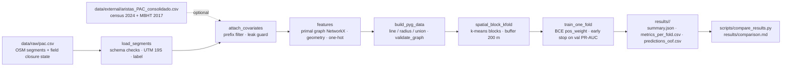

# Rejas-GNN · Graph Neural Networks for residential street closures in Pedro Aguirre Cerda

[](#testing) [](#installation) [](LICENSE)

Reproducible, spatially-validated benchmark of graph-based models that predict whether a street
segment (OSM edge) in the comuna of Pedro Aguirre Cerda (Santiago de Chile) carries a residential
closure ("reja": gate, fence or informal barrier). The repository replicates the data definitions
of the original study (*Rejas*, two-approach analysis: fractal density field + SOM of territorial
well-being) and extends it with a supervised, graph-aware formulation whose claims are testable.

## 0. Executive summary

Closures of streets and alleys (*rejas*) are a growing form of residential self-enclosure in
Santiago. Using a complete field survey of Pedro Aguirre Cerda (2 790 OSM segments, 217 social
closures) we (i) formalise the street network as a primal graph ``G`` and its dual line graph
``L(G)``, (ii) cast closure prediction as **node classification on L(G)**, (iii) benchmark four
model families (MLP, GCN, GraphSAGE, GATv2) under an **ablation protocol** — Experiment A:
topology + geometry only; Experiment B: A + zonal socio-economic covariates (Census 2024,
MBHT 2017) — (iv) evaluate with **spatial block cross-validation with buffer zones** over
**10 seeds (42–51)**, and (v) deliver **calibrated probability maps** P(closure | features) for
100 % of the segments as GeoPackage/GeoJSON. One command (`make run-all`) reproduces everything.

> **Guía narrada en español**, paso a paso con comandos, figuras y lectura de resultados:
> [`docs/guia_paso_a_paso.md`](docs/guia_paso_a_paso.md).

## 1. Scientific description

**Unit of analysis.** A street segment ``s`` between two OpenStreetMap nodes (N = 2 790 in PAC).
**Target.** ``y_s = 1`` if the field-surveyed state is `cierre`, `informal` or `medio`
(the original study's *SOCIAL_3cat*; 217 positives, 7.8 %); `abierta` and `condominio` are 0.
The definition is a config parameter (`data.positive_states`, `data.drop_condominio`).

**Research questions.**
1. *Relational signal* — does the topology of the street network (who connects to whom) carry
   information about closures beyond each segment's own attributes? Tested by comparing GNNs
   against non-relational baselines (logistic regression, MLP) on **identical** features.
2. *Which topology?* — connectivity (line graph) vs. spatial proximity (radius graph) vs. both.
3. *Spatial generalisation* — performance is measured on **spatially disjoint blocks with a
   buffer zone**, so the score reflects the ability to predict closures in an unseen
   neighbourhood, not the ability to interpolate between labelled neighbours.

**Graph formulation.** The segment-level target makes the natural object the **line graph**
``L(G)`` of the primal street graph ``G = (V_osm, E_seg)``: nodes of ``L(G)`` are segments, two
segments are adjacent iff they share an OSM node (built from the sparse incidence matrix,
``A = B Bᵀ`` minus the diagonal). A second topology connects segment midpoints within
``radius_m`` (k-d tree, degree-capped). Adjacency is binary, undirected, without self-loops and
validated by assertions (`rejas_gnn.data.graph.validate_graph`).

**Node attributes (no label information).**
| Block | Source | Examples |
|---|---|---|
| Network (primal graph, NetworkX) | `pac.csv` | degree/betweenness/closeness centrality, clustering, bridge, articulation, cul-de-sac |
| Geometry & road class | `pac.csv` | log length, orientation (sin/cos of 2θ), distance to centroid, OSM hierarchy, one-hot road group |
| Census 2024 (optional, 49 vars) | `aristas_PAC_consolidado.csv` (`cpv24_*`) | age structure, tenure, overcrowding, materials, services — inverse-distance averaged from blocks ≤ 150 m |
| MBHT 2017 (optional, 20 vars) | same (`uai_*`) | access, security, socio-economic indices (CIT-UAI) |

Missing covariates are median-imputed **and** flagged with a `__missing` indicator; features are
z-scored with **training-fold statistics only**.

**Models** (`src/rejas_gnn/models/`). All share the interface ``forward(x, edge_index) → logits[N]``.
| Name | Family | Why it is here |
|---|---|---|
| `logreg` | linear | Interpretable floor; equivalent to L2 logistic regression |
| `mlp` | non-relational | Same features as the GNNs, no message passing — the *ablation of the graph* |
| `gcn` | GCN (Kipf & Welling 2017) | Classical symmetric-normalised baseline |
| `sage` | **GraphSAGE** (Hamilton et al. 2017), mean aggregation | **Primary model.** Separate weights for self and neighbourhood (`root_weight=True`) suit a decision that is local but context-modulated; robust to the heavy-tailed degree of line graphs; inductive, so it transfers to another comuna without retraining |
| `gat` | GATv2 (Brody et al. 2022), 4 heads | Learns which neighbours matter; attention coefficients are exported for interpretation (`GAT.attention`) |

**Loss.** Binary cross-entropy with logits and `pos_weight = N_neg / N_pos` computed on the
training nodes of each fold (class imbalance 1 : 12). Adam, weight decay 5e-4, gradient clipping
at norm 5, early stopping on validation **PR-AUC** (patience 40, minimum 30 epochs).

**Validation protocol — spatial block cross-validation with buffer.**
Random splits are invalid here: Moran's *I* of the label on the line graph is 0.17 (positive and
highly significant for N = 2 790; the original study measured a 9× pair-correlation excess at ~40 m), so a random held-out segment would have its labelled neighbours in the training
set and the GNN would copy them. Instead (`rejas_gnn.data.splits`):
1. k-means on UTM coordinates partitions the comuna into `n_blocks = 20` contiguous blocks;
2. blocks are assigned to `n_folds = 5` folds (seeded permutation);
3. per fold: test = fold blocks; validation = 25 % of the remaining blocks; train = the rest;
4. **buffer**: every non-test node within `buffer_m = 200 m` of a test node is removed from
   train and validation (it still participates in message passing, unlabelled);
5. the whole procedure is repeated for 5 seeds → 25 (seed, fold) runs; each node is a test node
   exactly once per seed, giving out-of-fold (OOF) predictions for every segment.

**Metrics** (test blocks only): PR-AUC (primary, imbalance-aware), ROC-AUC, F1 / precision /
recall at the threshold maximising F1 on the validation blocks, MCC, Brier score, and Moran's
*I* of the OOF residuals (a model that leaves spatially structured residuals is missing signal).
Reported as mean ± SD across the 25 runs plus the pooled-OOF value.

### 1.1 Phase 1 — formal graph and task

* ``G = (V, E)``: ``V`` = OSM intersections (1 826), ``E`` = street segments (2 781 unique, 2 790 rows);
  undirected, edge weight = length (m). Built with NetworkX (`graph_builder.build_primal_graph`).
* ``L(G)``: line graph, nodes = segments, adjacency = shared intersection, from the sparse
  incidence matrix ``A = B Bᵀ − diag``. Variants: `radius` (midpoints within 150 m) and `union`.
* **Task**: node classification on ``L(G)`` ⇔ edge classification on ``G``. Link prediction is
  not appropriate: the edges of ``G`` are known; what is unknown is a binary attribute on them.
* **Baseline features (Experiment A, 29 columns)**: endpoint degree (min/max), degree/betweenness
  (exact, length-weighted)/closeness centrality and clustering (avg/max of the endpoints), bridge,
  articulation point, cul-de-sac, log length, orientation (sin/cos 2θ), distance to the comuna
  centroid, OSM hierarchy, one-hot road group (10 classes).
* **Enriched features (Experiment B, +~70 columns)**: 49 Census-2024 ratios and 20 MBHT indices,
  attached per segment as the inverse-distance mean of census blocks whose centroid lies within
  150 m (computed by the original study), plus missingness indicators. Both experiments share the
  same graph, splits, seeds and hyper-parameters; the only difference is `data.feature_set`.

### 1.2 Phase 2 — protocol

* Spatial block CV (20 k-means blocks → 5 folds, 25 % of remaining blocks for validation,
  200 m buffer; §Validation protocol below).
* **Seeds 42–51** (block partition, initialisation, sampling); metrics as mean ± SD over seeds.
* Architectures: GCN, GraphSAGE (primary), GATv2; MLP as the non-relational control (and
  logistic regression in the single-run CLI).
* Metrics: ROC-AUC, **PR-AUC** (primary), F1/precision/recall at the validation-optimal
  threshold, MCC, **Brier**, **ECE** (10 equal-mass bins), reliability tables; **isotonic
  calibration fitted on validation blocks** of each fold and applied to its test blocks.
* Probability maps: out-of-fold calibrated P(closure) for every segment, averaged over the 10
  seeds, with per-segment SD across seeds, written to `results/battery/<features>__<model>_p_closure.{gpkg,geojson}`.

## 2. Pipeline



## 3. Repository layout

```
rejas-gnn/
├── README.md · LICENSE · Makefile · pyproject.toml · requirements.txt · .gitignore
├── configs/                      one YAML per experiment; every parameter lives here
│   ├── base.yaml                 reference configuration (GraphSAGE, line graph)
│   ├── logreg.yaml  mlp.yaml  gcn.yaml  sage.yaml  gat.yaml
│   └── sage_radius.yaml  sage_union.yaml
├── data/
│   ├── raw/pac.csv               2 790 segments with field-surveyed closure state (input, versioned)
│   ├── external/aristas_PAC_consolidado.csv   census/MBHT covariates (from the original study)
│   └── processed/                cached PyG datasets (*.pt, generated, git-ignored)
├── src/rejas_gnn/
│   ├── data/graph_builder.py      Phase 1: geometries (GeoPandas) → G, L(G), network metrics, feature sets A/B
│   ├── models/gnn_architectures.py GCN · GraphSAGE · GATv2 (LayerNorm, ReLU, dropout)
│   ├── training/pipeline.py       Phase 2: ablation × architectures × seeds, calibration, exports
│   ├── evaluation/metrics_and_calibration.py  ROC/PR-AUC, F1, MCC, Brier, ECE, isotonic, GeoJSON/GPKG
│   ├── config.py                 typed dataclasses + YAML loader + validation
│   ├── seed.py                   set_global_seed (random, numpy, torch, PyG, deterministic kernels)
│   ├── logging_utils.py          audit log, environment fingerprint, JSON dump
│   ├── data/load.py              schema validation, projection, label
│   ├── data/features.py          NetworkX primal-graph metrics, geometry, covariate assembly
│   ├── data/graph.py             line/radius/union graph → torch_geometric.data.Data
│   ├── data/splits.py            spatial block k-fold with buffer
│   ├── models/{gnn,baselines,registry}.py
│   ├── metrics.py                PR-AUC, ROC-AUC, F1, MCC, Brier, Moran's I
│   ├── train.py                  full-batch loop, early stopping, repeated spatial CV
│   ├── pipeline.py               build_dataset · run
│   └── cli.py                    `rejas-gnn run --config ... --set key=value`
├── scripts/build_dataset.py · run_battery.py · compare_results.py · fig_01_graph.py · fig_02_splits.py · fig_03_map.py
├── tests/                        39 pytest tests; tests/test_pipeline.py = dimensions, NaNs, seed conservation, export
├── notebooks/                    exploratory analysis only; never the source of results
├── docs/                         guia_paso_a_paso.md (narrated walkthrough, ES) · spatial_cv.md · reference_results/ (Linux x86 + Apple M1)
└── results/                      generated: <experiment>/{summary.json, metrics_per_fold.csv, predictions_oof.csv}, logs/, comparison.md
```

## 4. Installation

Requires Python ≥ 3.10. CPU is sufficient (full benchmark ≈ 10 min on a laptop).

```bash
git clone https://github.com/<org>/rejas-gnn.git && cd rejas-gnn
python -m venv .venv && source .venv/bin/activate         # Windows: .venv\Scripts\activate
pip install --upgrade pip
pip install torch --index-url https://download.pytorch.org/whl/cpu   # or a CUDA build, see pytorch.org
pip install -e ".[dev]"                                   # == make install-dev
# or, with pinned versions:  conda env create -f environment.yml && conda activate rejas-gnn
make test                                                 # 33 tests must pass
```

`torch_geometric` is installed as a pure-Python package; the optional compiled extensions
(`pyg_lib`, `torch_scatter`, …) are **not** required.

## 5. Running

```bash
make data                       # build + cache the line-graph dataset (data/processed/*.pt)
make run MODEL=sage             # one experiment  → results/sage_line_pac/
make all                        # logreg, mlp, gcn, sage, gat on the line graph + comparison table
make graphs                     # GraphSAGE on radius and union graphs
make figures                    # figures for steps 2, 3 and 6 of the guide
make run-all                    # FULL BATTERY: ablation A/B × {mlp,gcn,sage,gat} × seeds 42–51 → results/battery/
make compare                    # results/comparison.md
```

Any parameter can be overridden from the command line without editing YAML:

```bash
rejas-gnn run --config configs/sage.yaml --set train.epochs=50 split.buffer_m=300 model.hidden_dim=128
rejas-gnn run --config configs/sage.yaml --set data.covariates_csv=null   # network+geometry features only
rejas-gnn run --config configs/sage.yaml --set data.drop_condominio=true  # alternative label definition
```

Outputs per experiment:
* `summary.json` — full config, environment fingerprint (versions, git commit), aggregate metrics,
  pooled-OOF metrics, Moran's *I* of label and residuals, feature names;
* `metrics_per_fold.csv` — one row per (seed, fold);
* `predictions_oof.csv` — out-of-fold closure probability for every segment (seed-averaged), with
  coordinates, ready for mapping or for ranking *candidate* segments (high `p_oof`, `y = 0`);
* `results/logs/run_<UTC>.log` — complete audit trail.

## 6. Reproducibility

* **Seeds.** `set_global_seed` seeds `random`, NumPy, PyTorch (CPU and CUDA), PyTorch Geometric,
  sets `PYTHONHASHSEED` and `CUBLAS_WORKSPACE_CONFIG`, and requests
  `torch.use_deterministic_algorithms(True)` with cuDNN in deterministic mode. The seed is reset
  before every (seed, fold) run, so each run is independent of execution order.
* **Blocks and folds** are a deterministic function of the seed (`KMeans(random_state=seed)`,
  `numpy.random.default_rng(seed)`). `tests/test_splits.py::test_deterministic_given_seed` and
  `tests/test_train.py::test_run_experiment_is_deterministic` enforce bit-wise identical results
  on CPU.
* **No hidden state.** Notebooks call package functions only; every parameter is in `configs/`.
* **Versions.** The reference run used Python 3.12, torch 2.14 (CPU), torch_geometric 2.8,
  numpy 2.4, scikit-learn 1.8, networkx 3.6. Pin exact versions with `pip freeze > requirements.lock`
  before publishing. On GPU, scatter-based aggregations may be non-deterministic; the pipeline warns
  (`warn_only=True`) instead of failing — use `train.device: cpu` for exact replication.
* **Replicating the reference table.** `make clean && make all && make graphs` regenerates
  `results/comparison.md`; values must match the table in §7 exactly on CPU with the pinned versions.

## 7a. Ablation battery (PAC, line graph, 5 folds × 10 seeds 42–51)

| Features       | Model   |   #feat | PR-AUC        | ROC-AUC       | F1            | MCC           | Brier raw→cal   | ECE raw→cal   |   Moran I resid. |
|:---------------|:--------|--------:|:--------------|:--------------|:--------------|:--------------|:----------------|:--------------|-----------------:|
| geometry       | mlp     |      28 | 0.214 ± 0.020 | 0.794 ± 0.045 | 0.311 ± 0.047 | 0.258 ± 0.056 | 0.171 → 0.077   | 0.241 → 0.053 |            0.224 |
| geometry       | sage    |      28 | 0.207 ± 0.033 | 0.757 ± 0.048 | 0.289 ± 0.053 | 0.236 ± 0.061 | 0.145 → 0.077   | 0.184 → 0.051 |            0.23  |
| geometry_socio | sage    |     168 | 0.191 ± 0.038 | 0.710 ± 0.065 | 0.247 ± 0.067 | 0.180 ± 0.089 | 0.119 → 0.083   | 0.120 → 0.059 |            0.253 |
| geometry_socio | mlp     |     168 | 0.186 ± 0.023 | 0.712 ± 0.055 | 0.264 ± 0.057 | 0.199 ± 0.070 | 0.140 → 0.080   | 0.177 → 0.054 |            0.233 |
| geometry_socio | gat     |     168 | 0.130 ± 0.031 | 0.616 ± 0.045 | 0.168 ± 0.046 | 0.086 ± 0.050 | 0.180 → 0.089   | 0.217 → 0.073 |            0.266 |
| geometry       | gat     |      28 | 0.123 ± 0.018 | 0.630 ± 0.032 | 0.180 ± 0.025 | 0.096 ± 0.029 | 0.179 → 0.084   | 0.240 → 0.061 |            0.232 |
| geometry       | gcn     |      28 | 0.122 ± 0.020 | 0.610 ± 0.050 | 0.172 ± 0.025 | 0.083 ± 0.032 | 0.193 → 0.080   | 0.277 → 0.055 |            0.215 |
| geometry_socio | gcn     |     168 | 0.116 ± 0.026 | 0.592 ± 0.050 | 0.169 ± 0.030 | 0.083 ± 0.037 | 0.165 → 0.092   | 0.208 → 0.072 |            0.275 |

Metrics are computed on the pooled out-of-fold predictions of each seed (every segment is a test
segment once per seed) and then averaged over the 10 seeds. Random-classifier PR-AUC = 0.078.

## 7b. Single-run reference (PAC, line graph, 5 folds × 5 seeds 0–4)

See `results/comparison.md` after running `make all`. The table below is the reference run
(filled from `results/comparison.md`; CPU, versions as in §6).

| experiment      | model   | graph   | PR-AUC        | ROC-AUC       | F1            | MCC           |   Brier |   pooled OOF PR-AUC |   resid. Moran I |
|:----------------|:--------|:--------|:--------------|:--------------|:--------------|:--------------|--------:|--------------------:|-----------------:|
| mlp_line_pac    | mlp     | line    | 0.295 ± 0.115 | 0.808 ± 0.073 | 0.308 ± 0.123 | 0.268 ± 0.117 |   0.12  |               0.251 |            0.254 |
| sage_radius_pac | sage    | radius  | 0.294 ± 0.122 | 0.811 ± 0.080 | 0.287 ± 0.118 | 0.254 ± 0.116 |   0.113 |               0.292 |            0.242 |
| sage_union_pac  | sage    | union   | 0.282 ± 0.118 | 0.807 ± 0.077 | 0.296 ± 0.115 | 0.260 ± 0.113 |   0.115 |               0.303 |            0.238 |
| sage_line_pac   | sage    | line    | 0.268 ± 0.101 | 0.796 ± 0.072 | 0.291 ± 0.107 | 0.257 ± 0.101 |   0.114 |               0.244 |            0.247 |
| logreg_line_pac | logreg  | line    | 0.240 ± 0.119 | 0.780 ± 0.094 | 0.242 ± 0.136 | 0.199 ± 0.133 |   0.217 |               0.245 |            0.327 |
| gat_line_pac    | gat     | line    | 0.171 ± 0.096 | 0.666 ± 0.105 | 0.164 ± 0.087 | 0.100 ± 0.086 |   0.156 |               0.153 |            0.379 |
| gcn_line_pac    | gcn     | line    | 0.156 ± 0.097 | 0.643 ± 0.090 | 0.175 ± 0.097 | 0.100 ± 0.101 |   0.169 |               0.156 |            0.322 |

Label Moran's *I* on the line graph: 0.170. PR-AUC of a random classifier = prevalence = 0.078.

Interpretation guide: the gap between `sage`/`gat` and `mlp` isolates the value of message
passing; a residual Moran's *I* close to 0 indicates the model has absorbed the spatial structure.

## 8. Leakage audit (what is guaranteed)

| Risk | Guard |
|---|---|
| Label columns entering features | `LABEL_LEAK_COLUMNS` assertion in `attach_covariates` and `assemble_feature_matrix`; `tests/test_features.py` |
| Test statistics in normalisation | `standardise` uses training nodes only; `tests/test_train.py::test_standardise_uses_train_only` |
| Neighbour labels reaching test nodes | buffer zone; `tests/test_splits.py::test_buffer_excludes_near_test_nodes` |
| Threshold tuned on test | threshold chosen on validation blocks only |
| Transductive message passing | documented: test nodes exchange *features*, never *labels*; network features (centralities) are label-free functions of the whole graph |
| Census/MBHT covariates | computed from blocks within 150 m of the segment by the original study; they are label-free but *spatially smooth*, which is one more reason for the buffer |

Known limitations: covariates are 2017/2024 while closures were surveyed mostly in 2025; the
`año` column of `pac.csv` is undocumented; `condominio` segments are treated as negatives to match
the original study (switchable).

## 9. Testing

```bash
make test            # pytest, 33 tests
make lint            # ruff + mypy
```

Tests cover: line-graph adjacency against a hand-computed toy network, radius-graph bounds,
undirectedness / no self-loops, absence of label columns, missingness indicators, fold
disjointness and coverage, buffer enforcement, split determinism, forward shapes of all models,
that GNNs depend on `edge_index` and baselines do not, bit-wise model determinism, attention
export, and end-to-end determinism of `run_experiment`.

## 10. Extending to another comuna (inductive transfer)

1. Put `data/raw/<comuna>.csv` with the same columns as `pac.csv`.
2. Copy `configs/base.yaml`, set `data.raw_edges_csv`, `name`, and (optionally) `data.covariates_csv`.
3. Run. For La Florida note that many streets appear twice (one row per direction); deduplicate
   or set `graph.type: union` so both directions share neighbours.

## 11. Citation

```bibtex
@software{rejas_gnn_2026,
  title   = {Rejas-GNN: graph neural networks for residential street closures in Pedro Aguirre Cerda},
  year    = {2026},
  url     = {https://github.com/<org>/rejas-gnn},
  version = {0.1.0}
}
```

References: Hamilton, Ying & Leskovec (2017) *Inductive representation learning on large graphs*,
NeurIPS · Kipf & Welling (2017) *Semi-supervised classification with graph convolutional networks*,
ICLR · Brody, Alon & Yahav (2022) *How attentive are graph attention networks?*, ICLR ·
Roberts et al. (2017) *Cross-validation strategies for data with temporal, spatial, hierarchical,
or phylogenetic structure*, Ecography · Fey & Lenssen (2019) *Fast graph representation learning
with PyTorch Geometric*.
