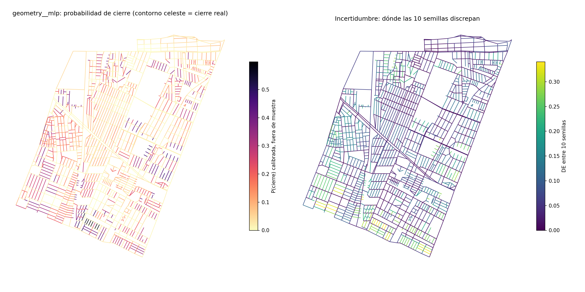
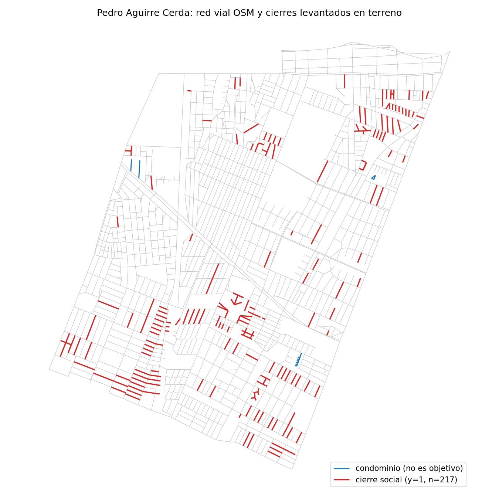
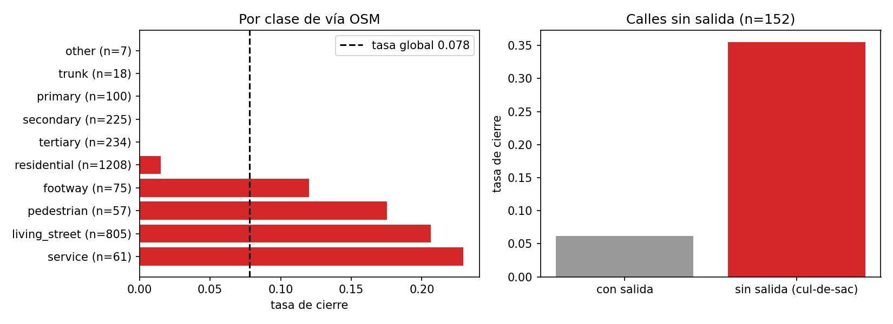
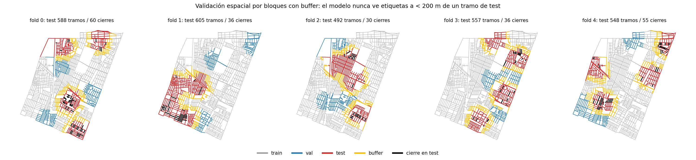
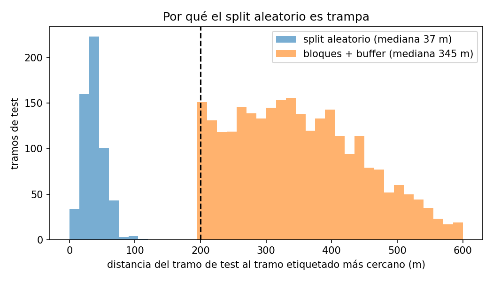
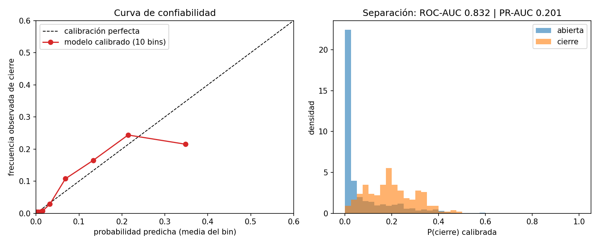
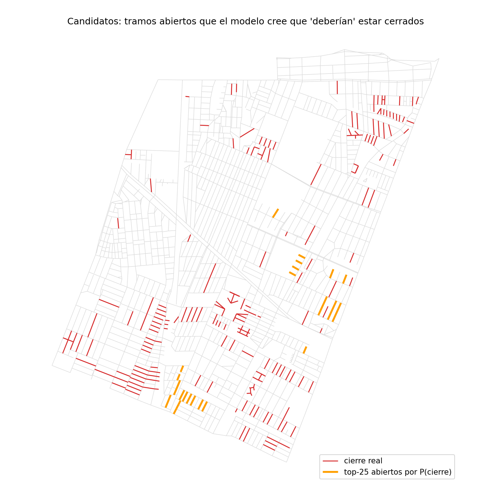

# Which streets get gated? Predicting residential closures in Pedro Aguirre Cerda from street-network morphology under spatial validation

[](https://github.com/gdosramos/rejas-gnn/actions)
[](https://github.com/gdosramos/rejas-gnn/releases)
[](#reproduce-it)
[](LICENSE)

> **Guía en español, paso a paso, con la lectura de cada resultado:** [`docs/guia_paso_a_paso.md`](docs/guia_paso_a_paso.md)

<p align="center">
  
  <br><em>Left: closure score of each street segment, predicted for neighbourhoods the model never saw (MLP, block A). Right: how much ten independent runs disagree. The score ranks segments; it is not a reliable probability (see “What we found”).</em>
</p>

## The question

In Pedro Aguirre Cerda (PAC), a working-class comuna of Santiago de Chile, residents have gated
hundreds of alleys and streets with fences and portones, a practice known locally as *rejas*. A
field survey classified every one of the comuna's 2 790 street segments as open, gated, informally
gated, half-gated or belonging to a condominium. The pattern is visible on a map; what is not obvious
is whether it is *predictable*:

**Can we tell which segments get gated from their position in the street network and from the
characteristics of their surroundings — and how much does each kind of information contribute?**

An earlier study of the same data described the pattern with two exploratory tools (a fractal
density field and a self-organising map of territorial well-being indices). This repository turns
the question into a falsifiable one: a model that has never seen a neighbourhood has to predict its
closures, and we measure how well it does.

## The data

Closures are not scattered. They come in **combs**: rows of short, parallel, dead-end alleys that
open onto a collector street, the morphology of the social-housing estates built in the 1960s–80s.
The alley is the unit that gets gated, and because alleys come in series, so do the gates.

<p align="center">
  
</p>

| | |
|---|---|
| Street segments (OpenStreetMap edges) | 2 790 |
| Social closures (`cierre` + `informal` + `medio`), the target | **217 (7.8 %)** |
| Condominium gates (structural, not a target) | 22 |
| Intersections | 1 826 |
| Spatial autocorrelation of the label (Moran's *I* on the street graph) | 0.17 |

The survey file (`data/raw/pac.csv`) is versioned in this repository, so everything below can be
regenerated from scratch.

## What the model sees

The natural object for a segment-level question is the **line graph** of the street network: each
segment is a node, and two segments are neighbours when they share an intersection. On this graph
the task is node classification — is this segment gated or not? — and graph neural networks can,
in principle, use what happens on neighbouring segments.

Every segment is described by two blocks of attributes, and the contrast between them is the core
experiment of the study:

| Block | What it contains | Count |
|---|---|---|
| **A · Topology & geometry** | position in the network (degree, betweenness, closeness, clustering, bridge, articulation point, **dead end**), length, orientation, distance to the centroid, OSM road class | 28 |
| **B · + Zonal socio-economics** | A plus 50 Census 2024 variables and 21 MBHT 2017 variables (each source includes the number of census blocks averaged), attached from the census blocks within 150 m, plus 2 missingness flags | 101 |

Block A alone already tells a lot:

<p align="center">
  
</p>

Living streets, service roads and pedestrian ways are gated 18–23 % of the time; residential streets
1.5 %; avenues never. A **dead end is gated 5.7 times more often** (35.5 % vs 6.2 %).

## The enriched data: what "zonal socio-economics" means here

The ablation hinges on a second block of attributes that does not come from the street network
but from two official sources, both at the level of the **census block** (*manzana*), the smallest
unit for which Chile publishes such data. The earlier study attached them to each street segment
and we reuse that consolidated table (`data/external/aristas_PAC_consolidado.csv`) unchanged.

**Source 1 — Census 2024 (INE), 49 indicators per block.** Proportions and averages describing who
lives there and how: age structure (`prop_ninos`, `prop_adultos_mayores`, `prom_edad`), household
composition (`prop_hog_unipersonal`, `prop_jefatura_mujer`, `prop_hog_allegados`), education and
work (`prom_escolaridad18`, `prop_educ_superior`, `tasa_desocupacion`, `prop_ocup_manual`), tenure
(`prop_tenencia_propia`, `_arrendada`, `_cedida`), housing type and quality (`prop_viv_casa`,
`prop_viv_depto`, `prop_viv_precaria`, `prop_viv_hacinadas`, `prop_paredes_solidas`,
`prop_techo_precario`), services and mobility (`prop_internet_hog`, `prop_auto`,
`prop_transp_publico`, `prop_camina_trabajo`, `prop_alcantarillado`), and population density
(`densidad_hab_ha`). Column prefix `cpv24_`.

**Source 2 — Matriz de Bienestar Humano Territorial (MBHT, CIT-UAI, 2017), 20 indices per block.**
A composite of territorial well-being built by the Centro de Inteligencia Territorial of
Universidad Adolfo Ibáñez. It has three dimensions and a global score:

| Dimension | Indices (prefix `uai_`) |
|---|---|
| Access to urban goods (`dim_acc`) | green areas `iav`, culture `icul`, sports `idep`, health `isal`, services `iser`, education `iej` |
| Security (`dim_seg`) | property crime `igpe` / `igpr`, violent crime `ilpe` / `ilpr` (two scales each), social vulnerability `isv`, juvenile `ipj` |
| Socio-economic (`dim_soc`) | socio-economic level `ise`, housing `ivi`, human resources `irh`, employment `iem` |
| Global | `bht` |

How they reach a segment: for every street segment, the blocks whose centroid lies within 150 m
are averaged with weights 1/distance (the MBHT sub-block values are first averaged to the 2017
block). The result is a smooth field: neighbouring segments get almost identical values, which is
why these variables carry little *local* information and why the buffer in the spatial validation
matters for them too. Seven segments have missing values; they are median-imputed and flagged
with one indicator per source (`cpv24__any_missing`, `uai__any_missing`), so block B has 101
features (28 + 71 covariates + 2 flags). Up to v0.2 one flag per column was added, which produced
69 near-identical columns and a 168-feature block; the ablation was re-run without them.

Three honest caveats about this block. Its **timing does not match the target**: the `año`
column of the survey dates 109 of the 217 closures to 2012–2015 and 97 to 2022–2024, and only 11
to 2025, so for most closures the census 2024 and even the MBHT 2017 are measured *after* the gate
was installed. It is **zonal, not segment-level**: it describes the block, not
the alley. And for the security indices there is a possible **reverse causality**: a gated alley may
itself change recorded crime. These are exactly the reasons the ablation is designed as A (without)
versus A + B (with), rather than assuming the enrichment helps.

## The trap: a random train/test split would be cheating

Because closures come in combs, a randomly held-out alley almost always has its siblings — same
comb, same label — in the training set, 30 m away. Any model, and a graph neural network more than
any, would score well by copying the neighbour, having learnt nothing that transfers to an
unsurveyed neighbourhood.

We therefore evaluate with **spatial block cross-validation with buffer zones**: the comuna is cut
into 20 contiguous blocks; in each of 5 folds some blocks are the test set, a quarter of the
remaining blocks are used for early stopping and threshold selection, and every segment closer
than 200 m to a test segment loses its label (it stays in the graph, but teaches nothing).

<p align="center">
  
  
</p>

Under a random split, 99 % of test segments have a labelled segment within 100 m; with blocks and
buffer, none within 200 m. The price is real and declared: each fold trains on only 83–136 of the
217 closures, and the estimate is deliberately pessimistic — it measures extrapolation to a new
neighbourhood, which is what the question asks.

## The experiment

* **Models.** Two non-neural baselines: a lookup table P(gated | OSM road class, dead end) with
  12 cells, and an L2 logistic regression. A multilayer perceptron that ignores the graph, and three
  graph neural networks that use it: GCN, GraphSAGE and GATv2.
* **Ablation.** Every neural model is trained twice: with block A only, and with blocks A + B. The
  logistic regression is also refitted without road class and without distance to the centroid,
  to see where its signal comes from.
* **Repetition.** Ten random seeds (42–51). The seed fixes the spatial block partition, so all
  models are evaluated on exactly the same held-out neighbourhoods in each seed.
* **Loss and optimisation (neural models).** Weighted binary cross-entropy (positives are 1 in 12),
  Adam, early stopping on validation PR-AUC. The same hyper-parameters are used for every
  architecture; no architecture-specific tuning was done.
* **Metrics.** PR-AUC (the honest metric for 7.8 % positives; chance = 0.078) and ROC-AUC for
  ranking; F1 and MCC at a threshold chosen on validation; for probabilities, Brier score, its
  **skill score (BSS) against predicting the prevalence for every segment**, and ECE. Probabilities
  are calibrated by isotonic regression fitted on the validation blocks only.
* **Comparisons.** Every claim “A is better than B” is tested on the ten per-seed differences
  (same partitions): mean difference, 95 % bootstrap CI and exact Wilcoxon signed-rank test
  (`make paired`). With ten seeds the smallest attainable p-value is 0.002, and a non-significant
  difference means “not shown”, not “equal”.

## What we found

Results on the test blocks, mean ± SD over the ten seeds, block A features (Apple M1 run; full
tables, including block A + B, in [`docs/reference_results/v03_apple_m1/`](docs/reference_results/v03_apple_m1/)):

| Model | Features | PR-AUC | ROC-AUC | BSS (calibrated) |
|---|---|---|---|---|
| **Logistic regression** | 28 | **0.286 ± 0.024** | **0.871 ± 0.012** | **+0.056** |
| Logistic regression, no distance to centroid | 27 | 0.218 ± 0.018 | 0.822 ± 0.016 | −0.002 |
| MLP | 28 | 0.211 ± 0.023 | 0.787 ± 0.061 | −0.067 |
| GraphSAGE | 28 | 0.206 ± 0.031 | 0.755 ± 0.048 | −0.080 |
| Lookup table: road class × dead end | 2 | 0.202 ± 0.025 | 0.805 ± 0.018 | +0.011 |
| Logistic regression, no road class | 18 | 0.197 ± 0.018 | 0.772 ± 0.013 | −0.003 |
| GATv2 | 28 | 0.127 ± 0.022 | 0.636 ± 0.028 | −0.165 |
| GCN | 28 | 0.122 ± 0.019 | 0.611 ± 0.050 | −0.116 |

Paired differences behind each finding (A − B over the ten seeds; [95 % CI]):

| Comparison | ΔPR-AUC | ΔROC-AUC | ΔBSS |
|---|---|---|---|
| Logistic regression − MLP | +0.076 [+0.061, +0.092] | +0.084 [+0.053, +0.125] | +0.124 [+0.084, +0.172] |
| MLP − GraphSAGE | +0.005 [−0.018, +0.027] | +0.032 [−0.001, +0.064] | +0.013 [−0.031, +0.055] |
| MLP − lookup table | +0.009 [−0.002, +0.019] | −0.018 [−0.049, +0.006] | −0.078 [−0.142, −0.020] |
| Block A − block A + B, MLP | +0.006 [−0.016, +0.030] | +0.050 [+0.008, +0.089] | +0.015 [−0.023, +0.059] |
| Block A − block A + B, GraphSAGE | +0.025 [+0.004, +0.047] | +0.064 [+0.025, +0.094] | +0.046 [−0.023, +0.118] |
| GraphSAGE − GCN | +0.084 [+0.059, +0.107] | +0.144 [+0.112, +0.174] | +0.036 [−0.001, +0.072] |
| Logistic: all − no road class | +0.089 [+0.079, +0.100] | +0.099 [+0.093, +0.105] | +0.059 [+0.030, +0.091] |
| Logistic: all − no distance to centroid | +0.068 [+0.061, +0.075] | +0.049 [+0.045, +0.053] | +0.059 [+0.033, +0.079] |

1. **Closures are predictable in unseen neighbourhoods, and a linear model does it best.** A
   logistic regression on 28 morphological attributes reaches PR-AUC 0.29 (3.7× chance) and ROC-AUC
   0.87, and beats the MLP and every graph network on ranking and on probability quality in all ten
   partitions.
2. **The signal is concentrated in a few variables.** Two of them, OSM road class and whether the
   segment is a dead end, already give ROC-AUC 0.81 as a 12-cell table, which the MLP does not beat
   on ranking and beats it on probabilities. Removing road class or the distance to the comuna's
   centroid costs the logistic model 0.07–0.09 PR-AUC each. The second result means that part of the
   signal is *where* a segment is, not only *what shape* it has; with spatial block validation this
   is still out-of-sample, but it is not a morphological effect.
3. **Using the graph adds nothing that can be demonstrated.** GraphSAGE is statistically
   indistinguishable from the MLP that ignores the graph, and GCN and GATv2 are clearly worse
   (ΔPR-AUC ≈ 0.08 against GraphSAGE). The cause of their failure is not established here: all
   architectures share one untuned training recipe. Residual spatial autocorrelation (Moran's *I*
   ≈ 0.22 against 0.17 for the label) shows that the spatial structure of closures is not captured
   by any model either.
4. **Zonal socio-economic covariates do not help.** Adding census 2024 and MBHT 2017 indices never
   improves any metric and consistently lowers ROC-AUC (by 0.05 for the MLP and 0.06 for
   GraphSAGE). The result holds after removing the 69 redundant missingness flags of v0.2. It is
   consistent with the timing problem described above (most covariates postdate the closures) and
   with the earlier study's SOM candidate blocks not being recovered by any predictive model
   (AUC 0.53).
5. **The neural models' probabilities should not be read as risks.** Isotonic calibration lowers
   ECE to ≈ 0.05, but every neural model has a negative Brier skill score: its calibrated
   probabilities are less accurate than predicting the prevalence (7.8 %) for every segment. Only
   the logistic regression (BSS +0.056) and, marginally, the lookup table carry probabilistic
   information. A low ECE alone is not evidence of useful probabilities when positives are rare.

<p align="center">
  
</p>

## The map, and what it is for

For every segment, the pipeline stores the calibrated score predicted when that segment was in the
test set, averaged over the ten seeds, together with the disagreement between seeds. The map shown
comes from the MLP; given finding 5 it should be read as a **ranking**, not as probabilities, and a
map from the logistic regression (the best model) is pending. That is
the figure at the top of this page, delivered as GeoPackage and GeoJSON
(`results/battery/<experiment>_p_closure.{gpkg,geojson}` after `make run-all`).

The most useful reading is the list of **open segments the model believes should be gated**:

<p align="center">
  
</p>

The top candidates are five living-street alleys in the south-west (Los Jazmines, Las Maravillas,
Los Geranios, Las Buganvilias, Los Tulipanes), tied at *p* = 0.60 because they share exactly the same
geometry, followed by segments of Avenida Clotario Blest. About 227 open segments have *p* ≥ 0.25.
These are hypotheses that a future survey can confirm or refute, which is what makes the study
predictive in the strict sense. Because the model ranks rather than predicts segment by segment,
the candidate list is a prioritisation for fieldwork, not a forecast.

## Replication of the original study

Before building anything new, the earlier study's code was re-run from the raw files. Both of its
approaches reproduce **exactly** (density exponents, the 9× pair-correlation excess at ~40 m, the
18 candidate cells; the 23 hot SOM neurons, the 94 candidate blocks, block-by-block assignment,
cluster profiles and regression coefficients). Two caveats emerged from that audit: the "fractal"
long-range exponent is mostly a finite-size effect (three quarters of the slope is present in a
null model with the same network geometry), and the SOM clusters and their interpretations rest on
a single random seed (17–19 % of blocks change status under other seeds). Details in
[`docs/guia_paso_a_paso.md`](docs/guia_paso_a_paso.md).

## Reproduce it

Requires Python ≥ 3.10; CPU is enough (the full battery takes 20–40 min on a laptop).

```bash
git clone https://github.com/gdosramos/rejas-gnn.git && cd rejas-gnn
conda create -n rejas-gnn python=3.11 -y && conda activate rejas-gnn
python -m pip install torch --index-url https://download.pytorch.org/whl/cpu
python -m pip install -e ".[dev]"
python -m pytest                      # 39 tests: graph, no-leakage features, buffer, determinism
```

| Command | What it does |
|---|---|
| `make figures` | regenerates every figure in this README (steps 2, 3 and 6 of the guide) |
| `make run MODEL=sage` | one model, 5 seeds × 5 spatial folds → `results/sage_line_pac/` |
| `make run-all` | the full battery: ablation A/B × 4 models × seeds 42–51, calibrated maps, `results/battery/battery_results.md` |
| `make test` · `make lint` | pytest · ruff + mypy |

Any parameter can be overridden without editing files, e.g.
`python -m rejas_gnn.cli run --config configs/sage.yaml --set data.feature_set=geometry split.buffer_m=300`.
Every run writes its full configuration, library versions, git commit and metrics to
`results/<experiment>/summary.json`, and a timestamped log to `results/logs/`.

**Determinism.** Seeds govern Python, NumPy, PyTorch (CPU/CUDA) and PyTorch Geometric, and
deterministic kernels are requested; the block partition is a function of the seed. Within a
machine, results are bit-for-bit reproducible (tested). Across machines (Linux x86 vs Apple M1,
both documented in `docs/reference_results/`), ranking metrics agree to the third decimal and
threshold metrics to the second, because of floating-point arithmetic — which is why AUCs are the
headline metrics.

## Repository map

```
configs/        one YAML per experiment; every parameter lives here, nothing is hard-coded
data/raw/       pac.csv — the field survey (2 790 segments)            [versioned]
data/external/  census 2024 + MBHT 2017 covariates per segment         [versioned]
src/rejas_gnn/
  data/graph_builder.py   geometries → primal graph → line graph, 28 topological/geometric features, feature sets A/B
  data/splits.py          spatial block k-fold with buffer
  models/gnn_architectures.py   GCN · GraphSAGE · GATv2 ;  models/baselines.py  MLP · logistic
  train.py                full-batch training, early stopping, repeated spatial CV
  training/pipeline.py    the battery: ablation × models × seeds, calibration, map export
  evaluation/metrics_and_calibration.py   PR/ROC-AUC, F1, MCC, Brier, ECE, isotonic, GeoPackage/GeoJSON
scripts/        run_battery.py · fig_01_graph.py · fig_02_splits.py · fig_03_map.py · compare_results.py
tests/          39 pytest tests
docs/           guia_paso_a_paso.md (ES) · README_technical_v0.1.md · spatial_cv.md · figures/ · reference_results/{battery_linux_x86, battery_apple_m1}
results/        generated, git-ignored
```

## Limitations and next steps

* Segment geometries are straight lines between endpoints; real polylines would refine lengths and maps.
* **The label mixes temporal cohorts.** All open segments carry `año` = 2025, while closures are
  dated mostly 2012–2015 (109) and 2022–2024 (97). The two cohorts follow the two Chilean laws that
  regulate street closures (Ley 20.499 of 2011, which requires a single access, and Ley 21.411 of
  2022, which extends closures to streets with two accesses), and the share of dead ends differs
  between them (31 % vs 19 %). Whether the closures come from municipal permit records or from
  field observation is being confirmed with the data provider; until then the model may be learning
  *legal eligibility* as much as residents' behaviour, and results stratified by cohort are pending.
* Condominium gates are treated as "not gated" to match the original study (`data.drop_condominio` switches this).
* Next: inductive transfer to La Florida (the pipeline supports it with one config file), an
  ablation by feature block (network / geometry / road class) to attribute the signal, and a
  follow-up survey of the 227 candidates.

## Citation

```bibtex
@software{rejas_gnn_2026,
  author  = {Ramos, Gerardo},
  title   = {Rejas-GNN: predicting residential street closures in Pedro Aguirre Cerda from street-network morphology},
  year    = {2026},
  version = {0.2.0},
  url     = {https://github.com/gdosramos/rejas-gnn}
}
```

References: Hamilton, Ying & Leskovec (2017) *Inductive representation learning on large graphs* ·
Kipf & Welling (2017) *Semi-supervised classification with graph convolutional networks* ·
Brody, Alon & Yahav (2022) *How attentive are graph attention networks?* ·
Roberts et al. (2017) *Cross-validation strategies for data with temporal, spatial, hierarchical, or phylogenetic structure* ·
Fey & Lenssen (2019) *Fast graph representation learning with PyTorch Geometric*.

MIT License.
