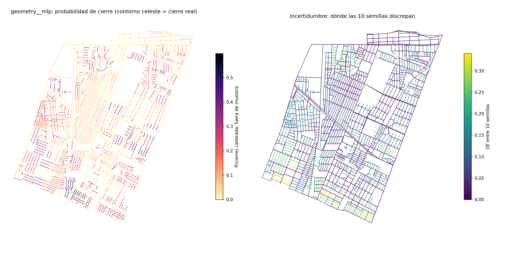
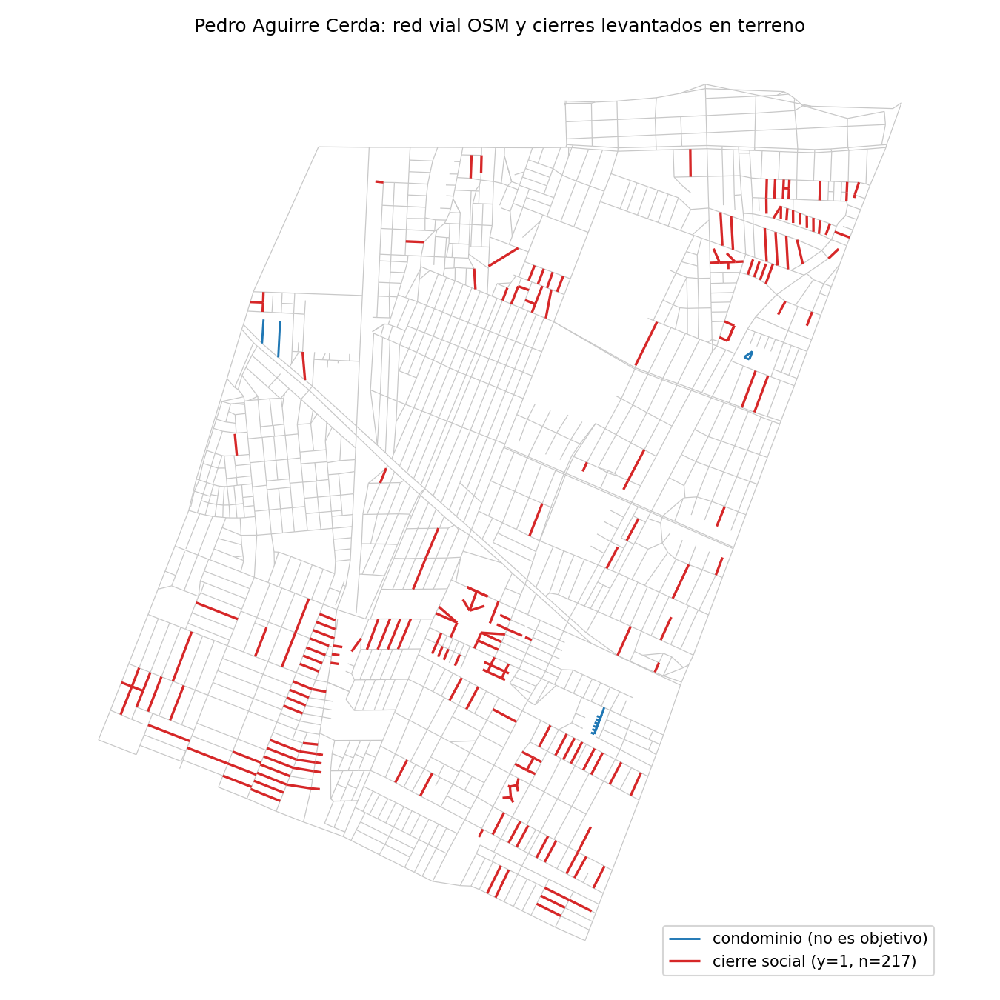
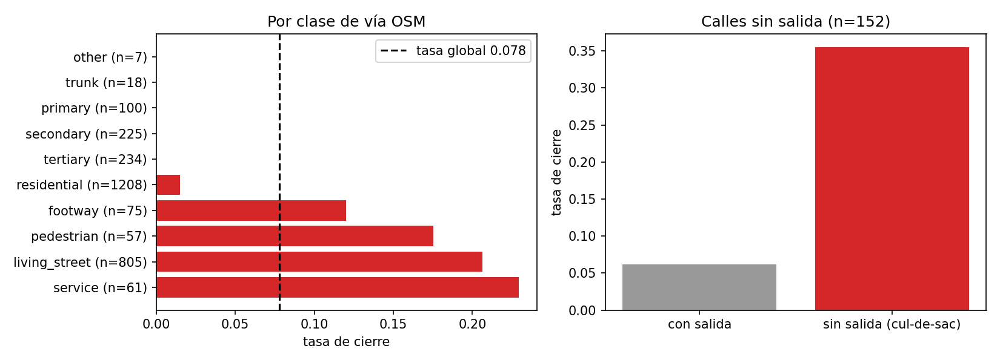
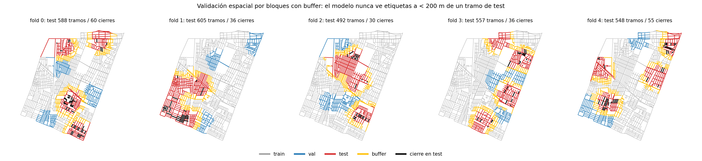
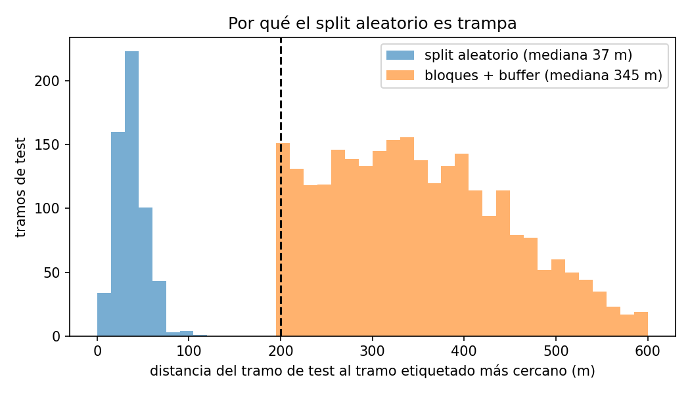
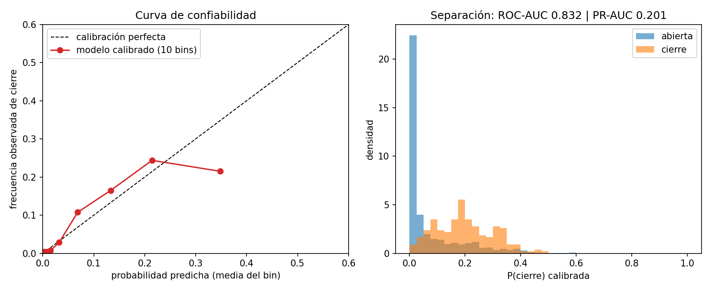
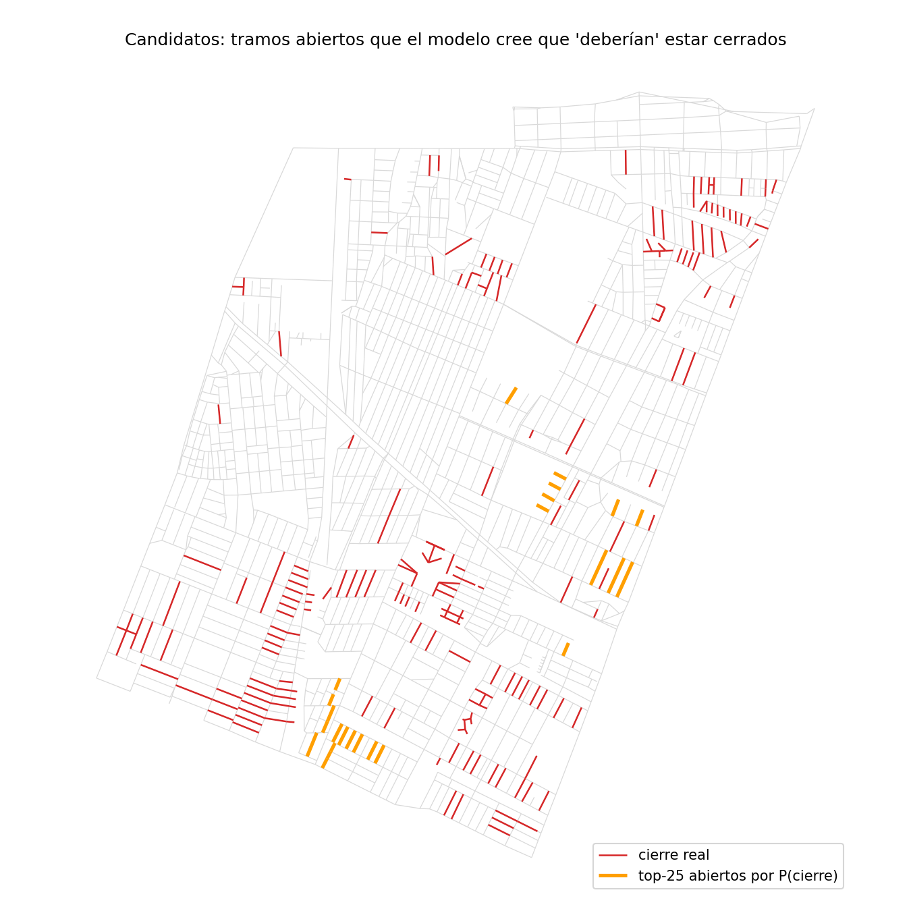

# Why do neighbours gate their streets? Predicting residential closures in Pedro Aguirre Cerda from the shape of the street network

[](https://github.com/gdosramos/rejas-gnn/actions)
[](https://github.com/gdosramos/rejas-gnn/releases)
[](#reproduce-it)
[](LICENSE)

> **Guía en español, paso a paso, con la lectura de cada resultado:** [`docs/guia_paso_a_paso.md`](docs/guia_paso_a_paso.md)

<p align="center">
  
  <br><em>Left: probability that a street segment is gated, predicted for neighbourhoods the model never saw. Right: how much ten independent runs disagree.</em>
</p>

## The question

In Pedro Aguirre Cerda (PAC), a working-class comuna of Santiago de Chile, residents have gated
hundreds of alleys and streets with fences and portones, a practice known locally as *rejas*. A
field survey classified every one of the comuna's 2 790 street segments as open, gated, informally
gated, half-gated or belonging to a condominium. The pattern is visible on a map; what is not obvious
is whether it is *predictable*:

**Can we tell which segments get gated from their position in the street network and from the
characteristics of their surroundings — and how much does each kind of information contribute?**

An earlier study of the same data described the pattern with two exploratory tools (a fractal
density field and a self-organising map of territorial well-being indices). This repository turns
the question into a falsifiable one: a model that has never seen a neighbourhood has to predict its
closures, and we measure how well it does.

## The data

Closures are not scattered. They come in **combs**: rows of short, parallel, dead-end alleys that
open onto a collector street, the morphology of the social-housing estates built in the 1960s–80s.
The alley is the unit that gets gated, and because alleys come in series, so do the gates.

<p align="center">
  
</p>

| | |
|---|---|
| Street segments (OpenStreetMap edges) | 2 790 |
| Social closures (`cierre` + `informal` + `medio`), the target | **217 (7.8 %)** |
| Condominium gates (structural, not a target) | 22 |
| Intersections | 1 826 |
| Spatial autocorrelation of the label (Moran's *I* on the street graph) | 0.17 |

The survey file (`data/raw/pac.csv`) is versioned in this repository, so everything below can be
regenerated from scratch.

## What the model sees

The natural object for a segment-level question is the **line graph** of the street network: each
segment is a node, and two segments are neighbours when they share an intersection. On this graph
the task is node classification — is this segment gated or not? — and graph neural networks can,
in principle, use what happens on neighbouring segments.

Every segment is described by two blocks of attributes, and the contrast between them is the core
experiment of the study:

| Block | What it contains | Count |
|---|---|---|
| **A · Topology & geometry** | position in the network (degree, betweenness, closeness, clustering, bridge, articulation point, **dead end**), length, orientation, distance to the centroid, OSM road class | 28 |
| **B · + Zonal socio-economics** | A plus 49 ratios from the 2024 Census and 20 territorial well-being indices (MBHT 2017), attached to each segment from the census blocks within 150 m | 168 |

Block A alone already tells a lot:

<p align="center">
  
</p>

Living streets, service roads and pedestrian ways are gated 18–23 % of the time; residential streets
1.5 %; avenues never. A **dead end is gated 5.7 times more often** (35.5 % vs 6.2 %).

## The enriched data: what "zonal socio-economics" means here

The ablation hinges on a second block of attributes that does not come from the street network
but from two official sources, both at the level of the **census block** (*manzana*), the smallest
unit for which Chile publishes such data. The earlier study attached them to each street segment
and we reuse that consolidated table (`data/external/aristas_PAC_consolidado.csv`) unchanged.

**Source 1 — Census 2024 (INE), 49 indicators per block.** Proportions and averages describing who
lives there and how: age structure (`prop_ninos`, `prop_adultos_mayores`, `prom_edad`), household
composition (`prop_hog_unipersonal`, `prop_jefatura_mujer`, `prop_hog_allegados`), education and
work (`prom_escolaridad18`, `prop_educ_superior`, `tasa_desocupacion`, `prop_ocup_manual`), tenure
(`prop_tenencia_propia`, `_arrendada`, `_cedida`), housing type and quality (`prop_viv_casa`,
`prop_viv_depto`, `prop_viv_precaria`, `prop_viv_hacinadas`, `prop_paredes_solidas`,
`prop_techo_precario`), services and mobility (`prop_internet_hog`, `prop_auto`,
`prop_transp_publico`, `prop_camina_trabajo`, `prop_alcantarillado`), and population density
(`densidad_hab_ha`). Column prefix `cpv24_`.

**Source 2 — Matriz de Bienestar Humano Territorial (MBHT, CIT-UAI, 2017), 20 indices per block.**
A composite of territorial well-being built by the Centro de Inteligencia Territorial of
Universidad Adolfo Ibáñez. It has three dimensions and a global score:

| Dimension | Indices (prefix `uai_`) |
|---|---|
| Access to urban goods (`dim_acc`) | green areas `iav`, culture `icul`, sports `idep`, health `isal`, services `iser`, education `iej` |
| Security (`dim_seg`) | property crime `igpe` / `igpr`, violent crime `ilpe` / `ilpr` (two scales each), social vulnerability `isv`, juvenile `ipj` |
| Socio-economic (`dim_soc`) | socio-economic level `ise`, housing `ivi`, human resources `irh`, employment `iem` |
| Global | `bht` |

How they reach a segment: for every street segment, the blocks whose centroid lies within 150 m
are averaged with weights 1/distance (the MBHT sub-block values are first averaged to the 2017
block). The result is a smooth field: neighbouring segments get almost identical values, which is
why these variables carry little *local* information and why the buffer in the spatial validation
matters for them too. Six to seven segments have missing values; they are median-imputed and
flagged with a `__missing` indicator so the model can see the gap.

Three honest caveats about this block. It is **older than the target** (MBHT 2017, census 2024,
closures surveyed mostly in 2025). It is **zonal, not segment-level**: it describes the block, not
the alley. And for the security indices there is a possible **reverse causality**: a gated alley may
itself change recorded crime. These are exactly the reasons the ablation is designed as A (without)
versus A + B (with), rather than assuming the enrichment helps.

## The trap: a random train/test split would be cheating

Because closures come in combs, a randomly held-out alley almost always has its siblings — same
comb, same label — in the training set, 30 m away. Any model, and a graph neural network more than
any, would score well by copying the neighbour, having learnt nothing that transfers to an
unsurveyed neighbourhood.

We therefore evaluate with **spatial block cross-validation with buffer zones**: the comuna is cut
into 20 contiguous blocks; in each of 5 folds some blocks are the test set, a quarter of the
remaining blocks are used for early stopping and threshold selection, and every segment closer
than 200 m to a test segment loses its label (it stays in the graph, but teaches nothing).

<p align="center">
  
  
</p>

Under a random split, 99 % of test segments have a labelled segment within 100 m; with blocks and
buffer, none within 200 m. The price is real and declared: each fold trains on only 83–136 of the
217 closures, and the estimate is deliberately pessimistic — it measures extrapolation to a new
neighbourhood, which is what the question asks.

## The experiment

* **Models.** A multilayer perceptron that ignores the graph (the control), and three graph neural
  networks that use it: GCN, GraphSAGE and GATv2. A logistic regression is available as a linear floor.
* **Ablation.** Every model is trained twice: with block A only, and with blocks A + B.
* **Repetition.** Ten random seeds (42–51), each producing a different block partition, model
  initialisation and sampling; 400 training runs in total.
* **Loss and optimisation.** Weighted binary cross-entropy (positives are 1 in 12), Adam, early
  stopping on validation PR-AUC.
* **Metrics.** PR-AUC (the honest metric for 7.8 % positives; chance = 0.078), ROC-AUC, F1 and MCC
  at the validation-chosen threshold, Brier score and expected calibration error (ECE).
  Probabilities are **calibrated by isotonic regression fitted on the validation blocks only**.

## What we found

Results on the test blocks, mean ± SD over the ten seeds (Apple M1 run; the Linux x86 run in
[`docs/reference_results/`](docs/reference_results/) differs in the third decimal):

| Features | Model | PR-AUC | ROC-AUC | F1 | Brier raw → calibrated | ECE raw → calibrated |
|---|---|---|---|---|---|---|
| A · geometry | **MLP** | **0.211 ± 0.023** | **0.787 ± 0.061** | 0.306 ± 0.053 | 0.172 → 0.077 | 0.242 → 0.053 |
| A · geometry | GraphSAGE | 0.206 ± 0.031 | 0.755 ± 0.048 | 0.287 ± 0.054 | 0.145 → 0.077 | 0.184 → 0.052 |
| A + B | GraphSAGE | 0.194 ± 0.042 | 0.716 ± 0.066 | 0.254 ± 0.068 | 0.118 → 0.082 | 0.119 → 0.060 |
| A + B | MLP | 0.192 ± 0.023 | 0.727 ± 0.056 | 0.272 ± 0.058 | 0.137 → 0.079 | 0.170 → 0.053 |
| A + B | GATv2 | 0.132 ± 0.030 | 0.622 ± 0.041 | 0.172 ± 0.045 | 0.176 → 0.087 | 0.209 → 0.071 |
| A · geometry | GATv2 | 0.127 ± 0.022 | 0.636 ± 0.028 | 0.191 ± 0.024 | 0.181 → 0.084 | 0.239 → 0.060 |
| A · geometry | GCN | 0.122 ± 0.019 | 0.611 ± 0.050 | 0.178 ± 0.018 | 0.193 → 0.080 | 0.277 → 0.056 |
| A + B | GCN | 0.117 ± 0.028 | 0.589 ± 0.048 | 0.169 ± 0.029 | 0.165 → 0.091 | 0.208 → 0.073 |

Three findings, each the opposite of what one might expect:

1. **The shape of the network is the signal.** Twenty-eight topological and geometric attributes,
   with no socio-economic information at all, rank a gated segment above an open one 79 % of the
   time in a neighbourhood the model never saw (PR-AUC 2.7× chance).
2. **Adding zonal socio-economics makes it worse**, not better (PR-AUC 0.21 → 0.19, ROC-AUC
   0.79 → 0.73 for the MLP). With 217 positives and 168 variables, the spatially smooth 2017 indices
   add noise rather than out-of-sample signal. This is consistent with a cross-check we ran: the
   94 "candidate" blocks of the earlier self-organising-map study are not recovered by any
   predictive model (AUC 0.53, i.e. chance).
3. **Looking at the neighbours does not help once leakage is removed.** The MLP, which ignores the
   graph, matches or beats GraphSAGE; GCN and GATv2 fail outright (over-smoothing and overfitting
   with few positives). The graph structure that makes closures *look* contagious is already encoded
   in each segment's own attributes — above all, whether it is a dead end.

A fourth, methodological finding: **raw model outputs are not probabilities.** With class weighting,
expected calibration error is 0.18–0.28; after isotonic calibration it drops to ≈ 0.05, so the maps
below can be read as "this segment is gated with probability *p*".

<p align="center">
  
</p>

## The map, and what it is for

For every segment, the pipeline stores the calibrated probability predicted when that segment was
in the test set, averaged over the ten seeds, together with the disagreement between seeds. That is
the figure at the top of this page, delivered as GeoPackage and GeoJSON
(`results/battery/<experiment>_p_closure.{gpkg,geojson}` after `make run-all`).

The most useful reading is the list of **open segments the model believes should be gated**:

<p align="center">
  
</p>

The top candidates are five living-street alleys in the south-west (Los Jazmines, Las Maravillas,
Los Geranios, Las Buganvilias, Los Tulipanes), tied at *p* = 0.60 because they share exactly the same
geometry, followed by segments of Avenida Clotario Blest. About 227 open segments have *p* ≥ 0.25.
These are hypotheses that a future survey can confirm or refute, which is what makes the study
predictive in the strict sense. The map does not guess segment by segment (PR-AUC 0.20); it
prioritises: the top decile concentrates a disproportionate share of the closures.

## Replication of the original study

Before building anything new, the earlier study's code was re-run from the raw files. Both of its
approaches reproduce **exactly** (density exponents, the 9× pair-correlation excess at ~40 m, the
18 candidate cells; the 23 hot SOM neurons, the 94 candidate blocks, block-by-block assignment,
cluster profiles and regression coefficients). Two caveats emerged from that audit: the "fractal"
long-range exponent is mostly a finite-size effect (three quarters of the slope is present in a
null model with the same network geometry), and the SOM clusters and their interpretations rest on
a single random seed (17–19 % of blocks change status under other seeds). Details in
[`docs/guia_paso_a_paso.md`](docs/guia_paso_a_paso.md).

## Reproduce it

Requires Python ≥ 3.10; CPU is enough (the full battery takes 20–40 min on a laptop).

```bash
git clone https://github.com/gdosramos/rejas-gnn.git && cd rejas-gnn
conda create -n rejas-gnn python=3.11 -y && conda activate rejas-gnn
python -m pip install torch --index-url https://download.pytorch.org/whl/cpu
python -m pip install -e ".[dev]"
python -m pytest                      # 39 tests: graph, no-leakage features, buffer, determinism
```

| Command | What it does |
|---|---|
| `make figures` | regenerates every figure in this README (steps 2, 3 and 6 of the guide) |
| `make run MODEL=sage` | one model, 5 seeds × 5 spatial folds → `results/sage_line_pac/` |
| `make run-all` | the full battery: ablation A/B × 4 models × seeds 42–51, calibrated maps, `results/battery/battery_results.md` |
| `make test` · `make lint` | pytest · ruff + mypy |

Any parameter can be overridden without editing files, e.g.
`python -m rejas_gnn.cli run --config configs/sage.yaml --set data.feature_set=geometry split.buffer_m=300`.
Every run writes its full configuration, library versions, git commit and metrics to
`results/<experiment>/summary.json`, and a timestamped log to `results/logs/`.

**Determinism.** Seeds govern Python, NumPy, PyTorch (CPU/CUDA) and PyTorch Geometric, and
deterministic kernels are requested; the block partition is a function of the seed. Within a
machine, results are bit-for-bit reproducible (tested). Across machines (Linux x86 vs Apple M1,
both documented in `docs/reference_results/`), ranking metrics agree to the third decimal and
threshold metrics to the second, because of floating-point arithmetic — which is why AUCs are the
headline metrics.

## Repository map

```
configs/        one YAML per experiment; every parameter lives here, nothing is hard-coded
data/raw/       pac.csv — the field survey (2 790 segments)            [versioned]
data/external/  census 2024 + MBHT 2017 covariates per segment         [versioned]
src/rejas_gnn/
  data/graph_builder.py   geometries → primal graph → line graph, 28 topological/geometric features, feature sets A/B
  data/splits.py          spatial block k-fold with buffer
  models/gnn_architectures.py   GCN · GraphSAGE · GATv2 ;  models/baselines.py  MLP · logistic
  train.py                full-batch training, early stopping, repeated spatial CV
  training/pipeline.py    the battery: ablation × models × seeds, calibration, map export
  evaluation/metrics_and_calibration.py   PR/ROC-AUC, F1, MCC, Brier, ECE, isotonic, GeoPackage/GeoJSON
scripts/        run_battery.py · fig_01_graph.py · fig_02_splits.py · fig_03_map.py · compare_results.py
tests/          39 pytest tests
docs/           guia_paso_a_paso.md (ES) · README_technical_v0.1.md · spatial_cv.md · figures/ · reference_results/{battery_linux_x86, battery_apple_m1}
results/        generated, git-ignored
```

## Limitations and next steps

* Segment geometries are straight lines between endpoints; real polylines would refine lengths and maps.
* Covariates date from 2017/2024, the survey mostly from 2025; the survey's `año` column and field
  protocol are undocumented.
* Condominium gates are treated as "not gated" to match the original study (`data.drop_condominio` switches this).
* Next: inductive transfer to La Florida (the pipeline supports it with one config file), an
  ablation by feature block (network / geometry / road class) to attribute the signal, and a
  follow-up survey of the 227 candidates.

## Citation

```bibtex
@software{rejas_gnn_2026,
  author  = {Ramos, Gerardo},
  title   = {Rejas-GNN: predicting residential street closures in Pedro Aguirre Cerda from street-network morphology},
  year    = {2026},
  version = {0.2.0},
  url     = {https://github.com/gdosramos/rejas-gnn}
}
```

References: Hamilton, Ying & Leskovec (2017) *Inductive representation learning on large graphs* ·
Kipf & Welling (2017) *Semi-supervised classification with graph convolutional networks* ·
Brody, Alon & Yahav (2022) *How attentive are graph attention networks?* ·
Roberts et al. (2017) *Cross-validation strategies for data with temporal, spatial, hierarchical, or phylogenetic structure* ·
Fey & Lenssen (2019) *Fast graph representation learning with PyTorch Geometric*.

MIT License.
